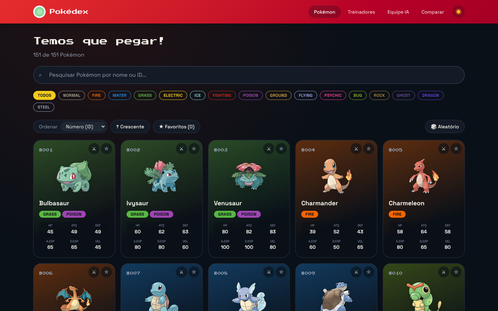
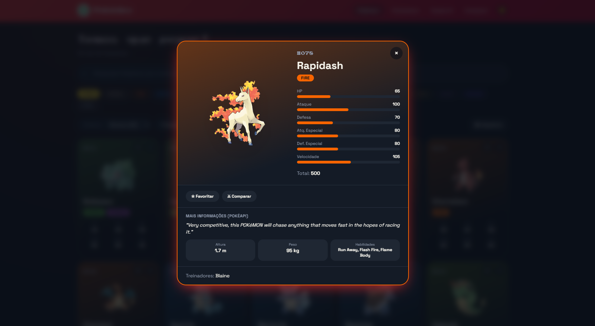
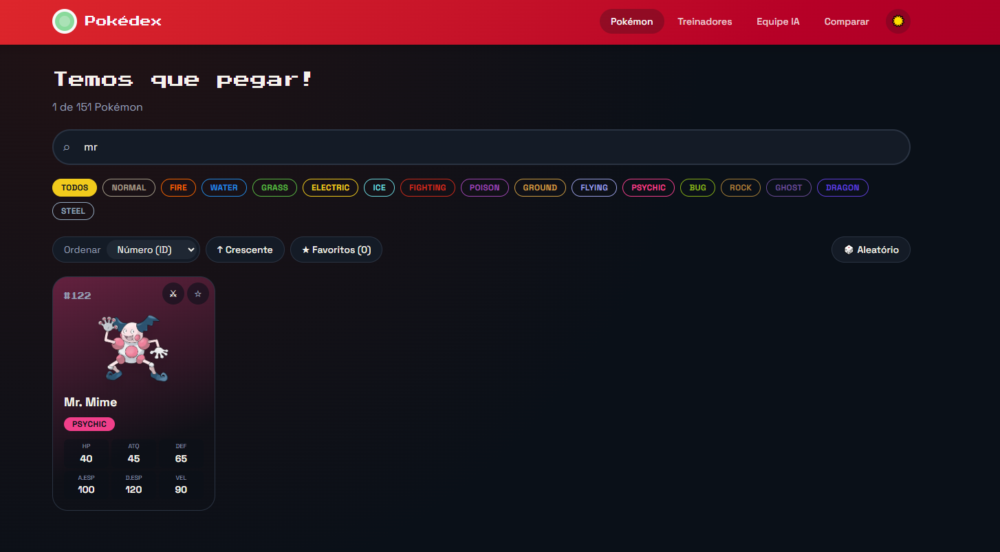
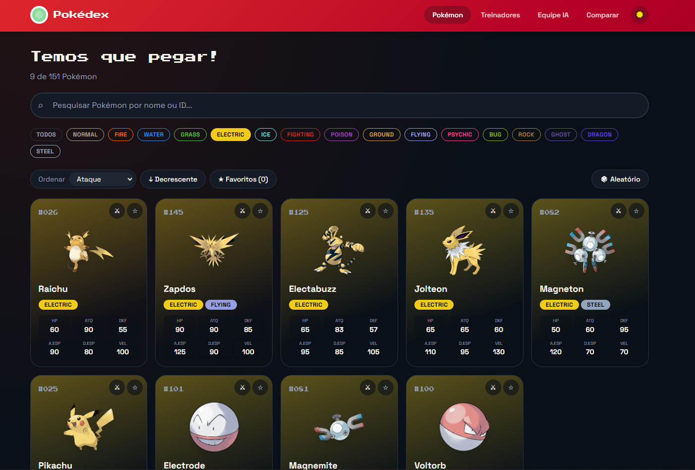
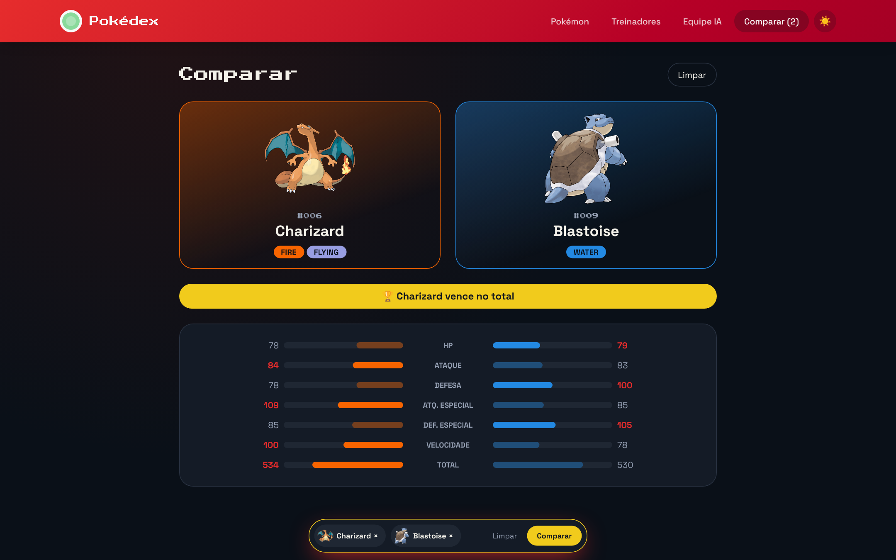
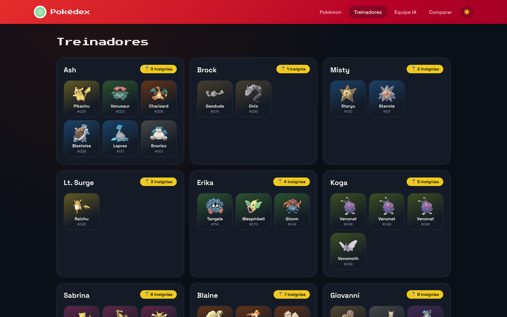
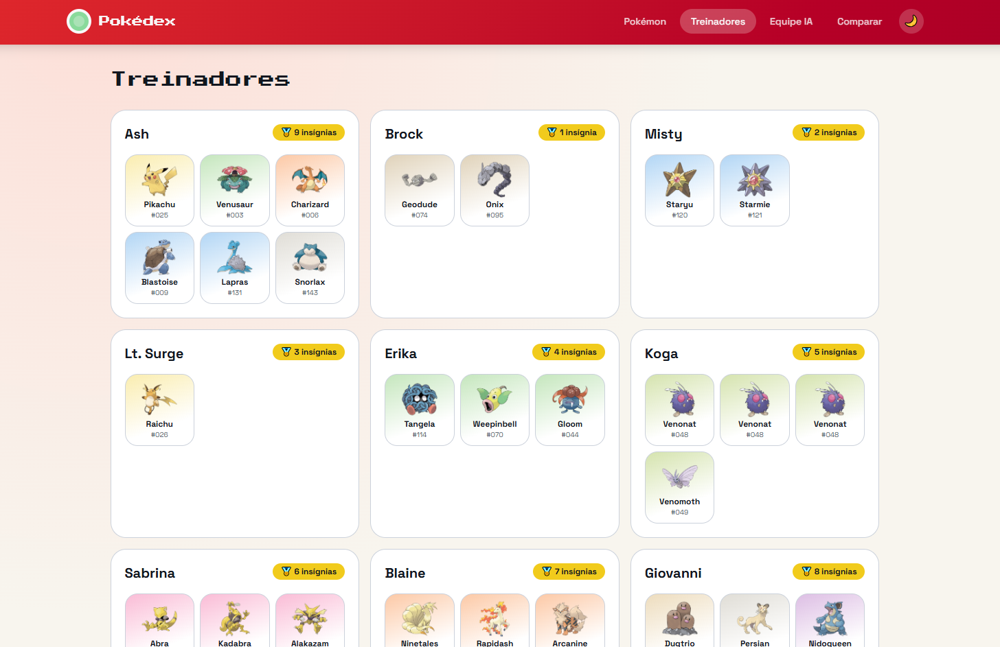
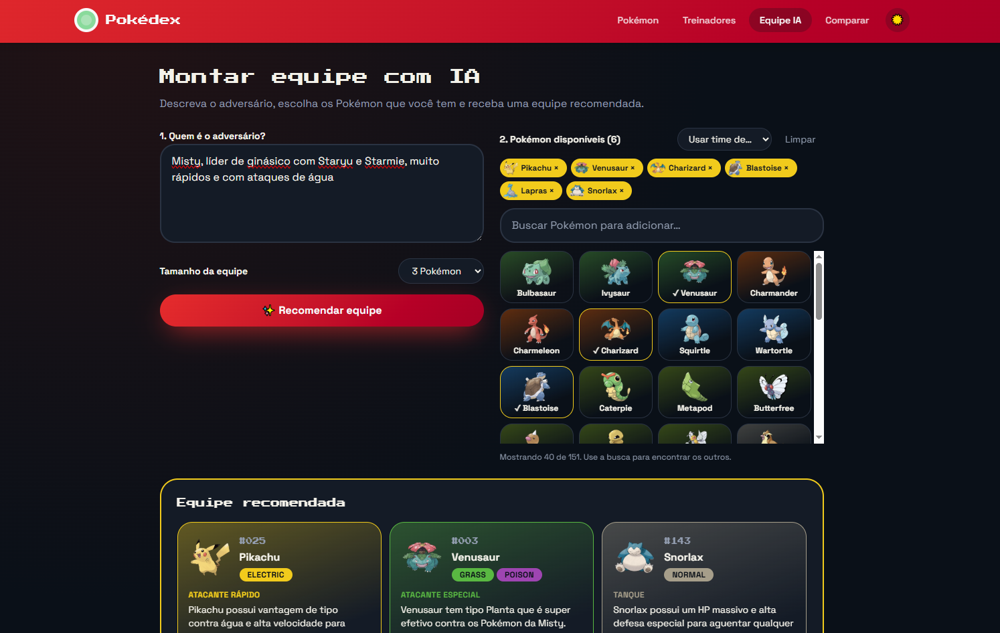
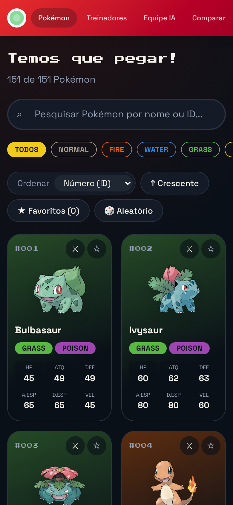

# 🎮 Pokédex — Atividade 03 (React + Vite)

Pokédex interativa com os 151 Pokémon de Kanto, feita com **React + Vite**.
Permite pesquisar por nome ou ID, filtrar por tipo, ver os detalhes e atributos de cada Pokémon,
consultar os treinadores, comparar dois Pokémon e montar uma equipe com ajuda de IA.

## 📸 Telas

| Pokédex                          | Detalhes                                  |
| -------------------------------- | ----------------------------------------- |
|  |  |

| Busca                             | Filtro por tipo                     |
| --------------------------------- | ----------------------------------- |
|  |  |

| Comparação                       | Treinadores                          |
| -------------------------------- | ------------------------------------ |
|  |  |

| Tema claro                         | Equipe IA                                         |
| ---------------------------------- | ------------------------------------------------- |
|  |  |

<p align="center">
  
</p>

## 👥 Alunos

- Bruna Pedrosa Nunes
- Cesar Lacerda Lima

## 🧰 Tecnologias

- [React 19](https://react.dev) + [Vite](https://vite.dev) + TypeScript
- [React Router](https://reactrouter.com) — navegação entre as páginas
- [Tailwind CSS](https://tailwindcss.com) — estilização
- [PokéAPI](https://pokeapi.co) — informações extras e imagens (opcional)
- [Google Gemini](https://ai.google.dev) — recomendação de equipe (opcional)
- [Vitest](https://vitest.dev) + Testing Library — testes

## ▶️ Como executar

Pré-requisito: [Node.js](https://nodejs.org) **20.19 ou mais novo** (recomendado: 22 LTS).

```bash
# 1. Instalar as dependências
npm install

# 2. Rodar o projeto
npm run dev
```

Abra **http://localhost:5173** no navegador.

O `npm run dev` sobe duas coisas ao mesmo tempo:

| Nome  | Endereço              | O que é                                           |
| ----- | --------------------- | ------------------------------------------------- |
| `web` | http://localhost:5173 | A Pokédex (Vite + React)                          |
| `ia`  | http://localhost:3001 | Servidor pequeno usado só pela página "Equipe IA" |

Sem a chave da IA, a Pokédex funciona normalmente; só a página **Equipe IA** mostra um aviso.

### Outros comandos

| Comando           | O que faz                                                                 |
| ----------------- | ------------------------------------------------------------------------- |
| `npm run dev:web` | Roda só a Pokédex, sem o servidor da IA                                   |
| `npm run build`   | Gera a versão de produção na pasta `dist/`                                |
| `npm run preview` | Abre a versão de produção (rode o `build` antes) em http://localhost:4173 |
| `npm test`        | Roda os testes                                                            |
| `npm run lint`    | Verifica o código com o oxlint                                            |

## 🤖 Configurar a IA (opcional)

A página **Equipe IA** recebe a descrição de um adversário e os Pokémon disponíveis e pede ao
Gemini uma equipe recomendada, com estratégia e ameaças.

1. Crie uma chave no [Google AI Studio](https://aistudio.google.com/apikey).
2. Copie o arquivo `.env.example` para `.env`.
3. Cole a chave em `GEMINI_API_KEY=` e rode `npm run dev` de novo.

> 🔒 A chave fica só no servidor (`server/index.js`) e nunca vai para o navegador.
> O `.env` está no `.gitignore`, então **não é enviado para o GitHub**.

Se quiser trocar o modelo, defina `GEMINI_MODEL` no `.env` (padrão: `gemini-flash-latest`).

## 📁 Dados

- **`src/data/pokedex-data.json`** — arquivo fornecido na atividade, com os Pokémon, atributos,
  tipos e treinadores. É a fonte principal da aplicação.
- **Imagens:** arte oficial do repositório [PokeAPI/sprites](https://github.com/PokeAPI/sprites)
  (`https://raw.githubusercontent.com/PokeAPI/sprites/master/sprites/pokemon/other/official-artwork/{id}.png`).
- **Informações extras** (altura, peso, habilidades e descrição): [PokéAPI](https://pokeapi.co),
  endpoints `pokemon/{id}` e `pokemon-species/{id}`. Se a API falhar, a Pokédex continua
  funcionando só com o JSON.

## 🗂️ Organização

```text
pokedex-react/
├── index.html               # página base do Vite
├── vite.config.ts           # configuração do Vite (React, Tailwind e proxy /api)
├── server/
│   └── index.js             # servidor da IA (Gemini) — guarda a chave fora do navegador
├── public/
│   └── favicon.svg
└── src/
    ├── main.tsx             # ponto de entrada: monta o React com o roteador
    ├── App.tsx              # layout (Header + páginas + barra de comparação) e rotas
    ├── index.css            # tema, cores dos tipos e animações
    ├── data/
    │   └── pokedex-data.json
    ├── components/          # componentes reutilizáveis
    │   ├── Header.tsx
    │   ├── SearchBar.tsx
    │   ├── Filters.tsx
    │   ├── Toolbar.tsx      # ordenação, favoritos e aleatório
    │   ├── PokemonList.tsx
    │   ├── PokemonCard.tsx
    │   ├── PokemonDetails.tsx
    │   ├── TypeBadge.tsx
    │   └── CompareBar.tsx
    ├── pages/               # uma página por rota
    │   ├── PokedexPage.tsx  # /
    │   ├── TrainersPage.tsx # /treinadores
    │   ├── ComparePage.tsx  # /comparar
    │   ├── TeamPage.tsx     # /equipe
    │   └── NotFoundPage.tsx # qualquer outro endereço
    ├── context/             # estado global: favoritos, comparação e tema
    ├── hooks/               # usePokedex, useLocalStorage, usePokeApi, useDocumentTitle
    ├── lib/
    │   ├── pokedex.ts       # tipos, pesquisa, filtro, ordenação e comparação
    │   ├── pokeapi.ts       # consulta à PokéAPI
    │   └── team.ts          # chamada ao servidor da IA
    └── test/                # testes (Vitest + Testing Library)
```

### Conceitos de React usados

- **Componentes funcionais e props** — ex.: `PokemonList` recebe a lista e renderiza um `PokemonCard` por Pokémon.
- **`useState`** — pesquisa, tipo selecionado, ordenação, Pokémon aberto nos detalhes.
- **Renderização de listas com `map()`** — cards, filtros de tipo, treinadores.
- **Eventos** — `onChange` na pesquisa, `onClick` nos filtros, cards e botões.
- **Estado derivado** — a lista exibida é calculada com `useMemo` a partir da pesquisa, filtro e ordenação.
- **`useEffect`** — busca na PokéAPI, tecla Esc no modal, título da aba, tema e `localStorage`.
- **Context + hooks próprios** — `PokedexProvider` e `usePokedex` compartilham favoritos, comparação e tema.

## ✅ Funcionalidades

### Requisitos

- Lista dos 151 Pokémon com ID, nome, tipos e os 6 atributos
- Pesquisa por nome ou ID (aceita `25`, `025` ou `#25`), atualizada enquanto digita
- Filtro por tipo (só os tipos presentes no JSON)
- Detalhes em modal com barras de atributos
- Página de treinadores com insígnias e Pokémon de cada um
- Mensagem quando nenhum Pokémon é encontrado
- Layout responsivo e identidade visual própria

### Desafios opcionais

- ⭐ **Favoritos** — salvos no navegador, com filtro "só favoritos"
- ⚔️ **Comparação** — escolha 2 Pokémon e veja quem vence em cada atributo e no total
- 📊 **Ordenação** — por ID, nome, HP, ataque, defesa, ataque especial, defesa especial e velocidade (crescente/decrescente)
- 🎲 **Pokémon aleatório**
- 🌙 **Tema claro/escuro** — a escolha fica salva
- 📱 **Responsividade avançada** — celular, tablet e desktop
- 🌐 **API externa** — PokéAPI nos detalhes

### Extra

- 🤖 **Equipe IA** — recomendação de equipe com o Google Gemini (precisa de chave, veja acima)
